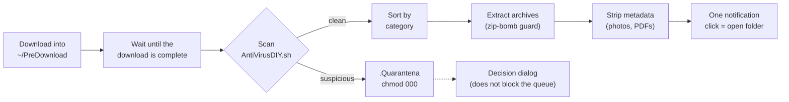

# MusiGuard

**An automatic download guardian for Linux desktops.**

MusiGuard watches a dedicated landing folder (`~/PreDownload`), scans every new
download, moves suspicious files to a locked quarantine, sorts clean files into
the right folders, extracts archives safely and sends a single notification per
file. Everything runs in the background as a systemd user service, written in
plain Bash.

> The user interface (dialogs, notifications, log messages) and the
> configuration keys are currently in **Italian**. The code is commented in
> English.

---

## Why

Browsers and torrent clients drop files straight into `~/Downloads`, where they
can be opened before anyone checks them, and where they pile up unsorted.
MusiGuard puts a checkpoint between "downloaded" and "usable":

- a download is touched only once it is **really finished** (important for torrents);
- it is **scanned** with several independent checks before it reaches your folders;
- anything suspicious is **isolated** immediately, and you decide later what to do;
- clean files are **sorted and cleaned** (archives extracted, tracking metadata removed);
- you are disturbed **once per file**, and never blocked by a pending decision.

## How it works



1. The browser (or torrent client) saves into `~/PreDownload`. Ideally this is a
   separate volume mounted `noexec,nosuid,nodev`, so nothing there can be
   executed, not even by mistake (an optional script creates it for you).
2. `guardiano-download.sh` listens with `inotifywait` and, for each new entry,
   waits until no process has it open for writing, it is no longer sparse, and
   its size/mtime are stable.
3. `AntiVirusDIY.sh` scans it. Checks, in order:
   - **MIME type vs. extension**: Linux (ELF, scripts) and Windows (PE)
     executables disguised as documents or media;
   - **name anti-spoofing**: misleading double extensions (`invoice.pdf.exe`,
     including space padding) and invisible / bidirectional Unicode characters
     (the RTLO trick);
   - **SHA256 from the clipboard**: if you copied the checksum from the download
     page, it is compared automatically; otherwise nothing happens;
   - **ClamAV**: `clamdscan` if the daemon is available, otherwise `clamscan`;
   - **VirusTotal** *(optional)*: lookup of the SHA256 hash only.
4. Clean files are moved to the right folder; suspicious ones go to
   `~/PreDownload/.Quarantena` with permissions `000`, and a dialog asks what to
   do (delete / keep in quarantine / ignore the risk and sort).
5. A weekly timer reviews the quarantine, optionally the system Trash, checks the
   age of the ClamAV signatures and rotates the logs.

## Features

### Security

| Check | What it does |
|---|---|
| MIME vs. extension | Detects executables (ELF, shell scripts, Windows PE) hidden behind `.pdf`, `.jpg`, etc. |
| Name anti-spoofing | Flags double extensions such as `file.pdf.exe` and invisible/directional Unicode characters in names. |
| Clipboard SHA256 | Compares the file with a SHA256 found in the clipboard. No popup; nothing is computed if there is no hash. |
| ClamAV | Uses `clamdscan` (signatures kept in memory) when available, with `clamscan` as fallback. Signature age is checked weekly. |
| Real quarantine | Suspicious entries are moved immediately to `~/PreDownload/.Quarantena` (on the `noexec` volume) with mode `000`; the reason is logged. |
| VirusTotal *(optional)* | Looks up only the SHA256 via API v3: the file never leaves the machine. Silent without a key or network. |

### File handling

- **Sorting by extension** into `Documents/Downloads`, `Pictures/Downloads`,
  `Videos/Downloads`, `Music/Downloads`, an archives folder and a 3D-printing
  folder (XDG user directories are honoured). Name collisions get `(1)`, `(2)`, ...
  If sorting is disabled, clean files go to `~/Downloads`.
- **Safe archive extraction** (`zip`, `tar.*`, `tgz`, `rar`, `7z`, and single
  `gz`/`bz2`/`xz`/`zst` files) into a dedicated folder, with a two-layer
  **zip-bomb guard** (`MAX_ESTRAZIONE_MB`). The original archive is deleted
  only after a successful extraction.
- **Metadata stripping** with `exiftool` (GPS, author, software) on sorted photos
  and PDFs, preserving orientation and colour profile.
- **Whole folders** (e.g. multi-file torrents) are scanned recursively and moved
  together into the category that weighs the most in bytes.
- **Incomplete-download protection**: size stability alone is not trusted;
  writers (`lsof` or `/proc`) and sparse files are checked too. The wait is
  capped by `ATTESA_MAX_MINUTI`.
- **Recovery at startup**: anything already in `~/PreDownload` is re-queued.
- **Weekly maintenance**: quarantine review (always), optional Trash review
  (list + confirmation, never automatic), ClamAV signature freshness check, log
  rotation.

### Robustness

`set -u` in every script, `flock` against duplicate instances, size-based log
rotation (4 backups), automatic restart by systemd (`Restart=on-failure`).

## Requirements

- A Linux desktop with systemd user sessions and a graphical session
  (GNOME or similar; tested on Debian/Ubuntu-style systems).
- Bash, coreutils, `inotify-tools`, `file`, `lsof` (optional, `/proc` fallback).
- `clamav` (recommended: `clamav-daemon` for fast scans).
- `zenity` and `libnotify-bin` for dialogs and notifications.
- Archive tools: `tar`, `unzip`, `unrar`, `p7zip-full`, optionally `zstd`.
- Clipboard: `wl-clipboard` (Wayland) or `xclip` (X11).
- Optional: `libimage-exiftool-perl` (metadata stripping), `curl` and `jq`
  (VirusTotal; `jq` has a grep fallback).
- `sudo` only for the optional isolated volume.

## Installation

**1. Install the dependencies** (Debian/Ubuntu):

```bash
sudo apt update
sudo apt install -y inotify-tools clamav zenity libnotify-bin \
    tar unzip unrar p7zip-full wl-clipboard lsof
# Recommended / optional
sudo apt install -y clamav-daemon zstd libimage-exiftool-perl curl jq
```

On X11 install `xclip` instead of `wl-clipboard`.

**2. Clone into `~/MusiGuard` and install.** The systemd units and the scripts
expect the project in `~/MusiGuard`.

```bash
git clone https://github.com/muzif98/musiguard.git ~/MusiGuard
cd ~/MusiGuard
chmod +x installa-servizio.sh scripts/*.sh
./installa-servizio.sh
```

On the first install two guided setups run in order: the **isolated volume**
(step 4) and the **module wizard**. The base module is the scanner: on its own
it does not sort, it only makes sure downloads are safe and moves them to
`~/Downloads`.

**3. Point your browser (and torrent client) to `~/PreDownload`** instead of
`~/Downloads`.

**4. *(Optional, recommended)* Isolated volume.** `crea-disco-predownload.sh`
turns `~/PreDownload` into a separate ext4 volume backed by a sparse image file
(`~/pre_download_disk.img`) and mounted with `noexec,nosuid,nodev` at every
boot. The chosen size is only a ceiling: the image uses only the space actually
occupied. Re-running it never reformats an existing image.

```bash
sudo ~/MusiGuard/scripts/crea-disco-predownload.sh        # default 50 GB
sudo ~/MusiGuard/scripts/crea-disco-predownload.sh 100    # custom size
```

Do not move or delete `~/pre_download_disk.img`: it holds the landing folder
and the quarantine.

### Uninstall

```bash
systemctl --user disable --now musiguard-guardiano.service musiguard-cestino.timer
rm ~/.config/systemd/user/musiguard-*
systemctl --user daemon-reload
```

If you created the isolated volume, also remove its line from `/etc/fstab`
(`pre_download_disk.img`), unmount `~/PreDownload` and delete the image.

## Configuration

Run the wizard at any time with `./scripts/configura.sh`, or edit
`~/.config/musiguard.conf` by hand. The file contains only `KEY=number` lines;
it is **parsed, never executed**. After a manual edit restart the service:
`systemctl --user restart musiguard-guardiano`.

| Key | Default | Effect |
|---|:---:|---|
| `ATTIVA_GUARDIANO` | `1` | Enable the guardian service watching `~/PreDownload` |
| `CHIEDI_SHA` | `1` | Compare against a SHA256 found in the clipboard |
| `CONTROLLO_VT` | `1` | VirusTotal second opinion (requires an API key) |
| `ESTRAI_ARCHIVI` | `1` | Automatic archive extraction |
| `SMISTA_ESTENSIONE` | `1` | Sort into category folders (otherwise `~/Downloads`) |
| `PULISCI_METADATI` | `1` | Strip metadata from photos and PDFs |
| `SVUOTA_CESTINO` | `0` | Weekly prompt to empty the system Trash (list + confirmation) |
| `MAX_ESTRAZIONE_MB` | `10240` | Maximum decompressed size for automatic extraction |
| `ATTESA_MAX_MINUTI` | `720` | Maximum wait for a download to finish; afterwards it stays in `~/PreDownload` |

The weekly quarantine review is not configurable: it always runs.

### VirusTotal (optional)

1. Create a free account on [virustotal.com](https://www.virustotal.com) and
   copy your API key from the profile menu.
2. Store it (64 hexadecimal characters):

```bash
install -m 600 /dev/null ~/.config/musiguard-vt.key
nano ~/.config/musiguard-vt.key   # paste the key on a single line
```

It is picked up immediately. Only the file hash is sent. The free plan allows 4
requests per minute; extra requests simply fail silently and ClamAV coverage
remains.

## Usage

Once installed there is nothing to run: download into `~/PreDownload` and
MusiGuard does the rest.

| Command | Purpose |
|---|---|
| `journalctl --user -u musiguard-guardiano -f` | Live guardian log |
| `cat ~/MusiGuard/estrazioni.log` | Waits, extractions and sorting events |
| `cat ~/MusiGuard/quarantena.log` | Quarantine history (files and reasons) |
| `ls -la ~/PreDownload/.Quarantena` | Current quarantine contents |
| `cat ~/MusiGuard/cestino.log` | Weekly Trash review history |
| `cat ~/MusiGuard/clamav.log` | Weekly ClamAV signature checks |
| `systemctl --user list-timers musiguard-cestino.timer` | Next weekly maintenance run |
| `systemctl --user start musiguard-cestino.service` | Run weekly maintenance now |

The scanner can also be used on its own:

```bash
~/MusiGuard/scripts/AntiVirusDIY.sh /path/to/file-or-folder
# exit 0 = clean, exit 1 = issues found (details on stdout)
```

## Project structure

```
MusiGuard/
├── installa-servizio.sh            # Entry point: installs/updates the systemd units ("install service")
├── scripts/
│   ├── guardiano-download.sh       # Guardian daemon watching ~/PreDownload ("download guardian")
│   ├── AntiVirusDIY.sh             # Scanner: MIME, name, SHA256, ClamAV, VirusTotal
│   ├── configura.sh                # Module wizard ("configure")
│   ├── crea-disco-predownload.sh   # Optional: noexec sparse volume for ~/PreDownload
│   └── pulizia-cestino.sh          # Weekly maintenance: ClamAV, Trash, quarantine, logs
├── systemd/
│   ├── musiguard-guardiano.service # Guardian service (Restart=on-failure)
│   ├── musiguard-cestino.service   # Oneshot, started only by the timer
│   └── musiguard-cestino.timer     # Weekly trigger (Persistent=true)
├── DESIGN.md                       # Design decisions and rationale
└── README.md
```

Runtime files: logs and lock files in `~/MusiGuard`, configuration in
`~/.config/musiguard.conf`, optional API key in `~/.config/musiguard-vt.key`.

## Security and privacy notes

- MusiGuard is a **safety net, not a full antivirus**. Detection relies on
  ClamAV signatures, heuristics on names and MIME types, and optionally
  VirusTotal hash lookups. A new or targeted threat can pass all of them.
- VirusTotal sees only the SHA256 of single files. A hash lookup reveals that
  you have a file with that hash; disable `CONTROLLO_VT` if that matters to you.
  Folders are never looked up.
- The configuration and the key file are parsed with strict patterns and never
  sourced or executed.
- Quarantined files keep mode `000` and live on the `noexec` volume when it is
  configured; the owner can still delete or restore them.
- Moving a completed torrent out of `~/PreDownload` stops seeding in the client;
  MusiGuard warns you when that happens.
- Nothing is ever deleted from the Trash or the quarantine without an explicit
  confirmation.
- Updating ClamAV signatures requires root and is not done automatically;
  MusiGuard only warns when they are older than 7 days.

### Known limits

- Requires a graphical session for dialogs and notifications (the services are
  bound to `graphical-session.target`).
- The installation path `~/MusiGuard` is fixed by the systemd units.
- Name and extension checks inside very large folders stop after 5000 files
  (ClamAV still scans everything).
- Office documents are not stripped of metadata (`exiftool` cannot rewrite them).
- UI strings and configuration keys are in Italian.

## License

MIT. See [LICENSE](LICENSE).
